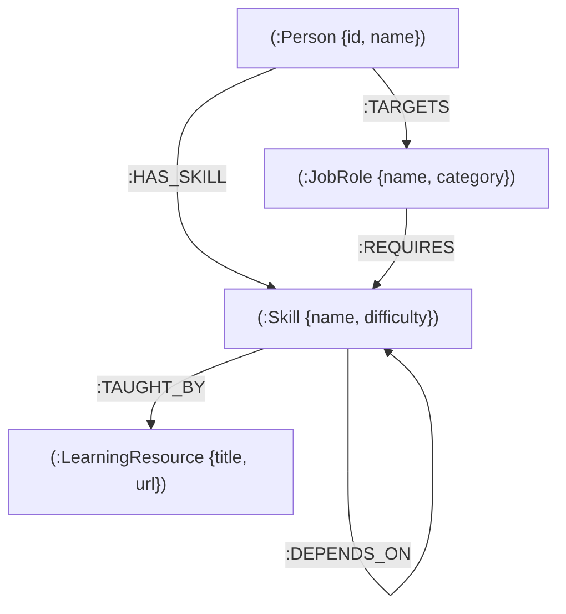

# 🧭 CAREER COMPASS — Neo4j Career Navigator & Skill Gap Agent

> **Transforming basic career roadmaps into an interactive, graph-powered knowledge workstation with Neo4j, Groq/Qwen AI, and Clerk authentication.**

Built for the **Neo4j Hackathon**, **CAREER COMPASS** uses graph topology to analyze candidate skill gaps, traverse prerequisite chains, and synthesize personalized step-by-step learning roadmaps with force-directed graph visualization.

---

## 🌟 Key Features

1. **Interactive Neo4j Knowledge Graph (Centerpiece)**
   - Visualizes career relationships using interactive force-directed D3 simulation.
   - Graph entities: `(Person)`, `(JobRole)`, `(Skill)`, and `(LearningResource)`.
   - Graph relationships: `[:TARGETS]`, `[:REQUIRES]`, `[:HAS_SKILL]`, `[:DEPENDS_ON]`, and `[:TAUGHT_BY]`.
   - Topological Next Skill detection with dynamic pulsing indicators (`.pulse-ring`).
   - Interactive zoom, drag physics, node filtering, and live Cypher query inspector.

2. **Graph-Derived Skill Gap Analysis**
   - Compares candidate's verified skills against target career requirements.
   - Computes mathematical skill coverage percentage from graph relationships.
   - Identifies missing core competencies and unfulfilled prerequisite dependencies.

3. **5-Day AI Study Plan Generator**
   - In-depth, day-by-day technical curriculum synthesized by Groq AI (`qwen/qwen3.8-27b`).
   - Resilient fallback curriculum engine ensuring zero-downtime offline demonstrations.

4. **Dynamic Graph Mastery**
   - Click any skill node to review graph prerequisites and curated resources.
   - **"Mark Skill Mastered in Graph"** updates the graph dynamically, recalculates coverage, and recalibrates the next recommended skill.

5. **Clerk Authentication**
   - Secure user authentication powered by Clerk.
   - Native in-page modal support with hosted redirect fallback.

6. **Neo-Brutalist Visual Design**
   - High-contrast 4px/8px black borders, drop shadows (`shadow-[8px_8px_0px_#000]`), and responsive layout.

---

## 🏗️ Neo4j Graph Model & Cypher Traversal



### Core Cypher Queries

#### 1. Skill Gap & Prerequisite Traversal
```cypher
MATCH (target:JobRole {name: $role})
OPTIONAL MATCH (candidate:Person {id: $userId})-[has:HAS_SKILL]->(known:Skill)
MATCH (target)-[req:REQUIRES]->(required:Skill)
OPTIONAL MATCH (required)-[dep:DEPENDS_ON*1..2]->(prereq:Skill)
RETURN target, collect(DISTINCT known) AS knownSkills,
       collect(DISTINCT required) AS requiredSkills,
       collect(DISTINCT prereq) AS prerequisites;
```

#### 2. Topological Next Priority Skill
```cypher
MATCH (target:JobRole {name: $role})-[:REQUIRES]->(s:Skill)
WHERE NOT (:Person {id: $userId})-[:HAS_SKILL]->(s)
  AND ALL(p IN [(s)-[:DEPENDS_ON]->(prereq) | prereq] 
      WHERE (:Person {id: $userId})-[:HAS_SKILL]->(p))
RETURN s
ORDER BY s.difficulty ASC
LIMIT 1;
```

---

## 🚀 Quick Start

### 1. Clone & Install
```bash
git clone https://github.com/dwivedi-mohit/CAREER-COMPASS.git
cd CAREER-COMPASS
npm install
```

### 2. Configure Environment
Copy the example environment file:
```bash
cp .env.example .env.local
```

Set your credentials in `.env.local`:
```env
PORT=4000
DEMO_MODE=true

# Neo4j Aura Instance
NEO4J_URI=neo4j+s://your-instance.databases.neo4j.io
NEO4J_USERNAME=neo4j
NEO4J_PASSWORD=your-neo4j-password

# Groq / LLM Key
LLM_API_KEY=gsk_your_key_here
LLM_MODEL=qwen/qwen3.8-27b

# Clerk Auth
CLERK_PUBLISHABLE_KEY=pk_test_...
CLERK_SECRET_KEY=sk_test_...
```

> **Note:** If `DEMO_MODE=true` or Neo4j credentials are empty, the application automatically activates high-fidelity In-Memory Graph mode for seamless hackathon evaluations.

### 3. Run the Application
```bash
npm start
```
Open **`http://localhost:4000`** in your browser.

---

## 🛠️ Tech Stack

- **Graph Database**: Neo4j (Cypher, Graph Traversal, Aura DB)
- **Backend**: Node.js, Express, Neo4j JavaScript Driver
- **Frontend**: HTML5, Tailwind CSS, D3.js (v7 Force-Directed Graphs)
- **AI Intelligence**: Groq API (`qwen/qwen3.8-27b`)
- **Authentication**: Clerk Express SDK & Clerk Browser JS
- **Design System**: Neo-Brutalist High-Contrast UI
